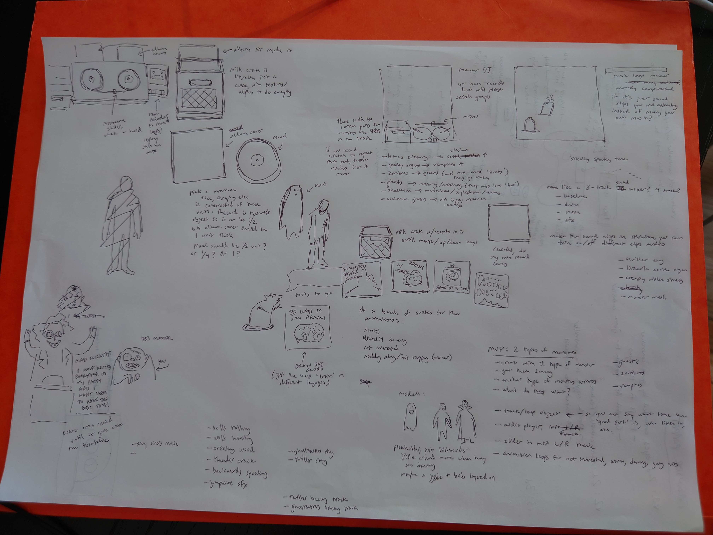
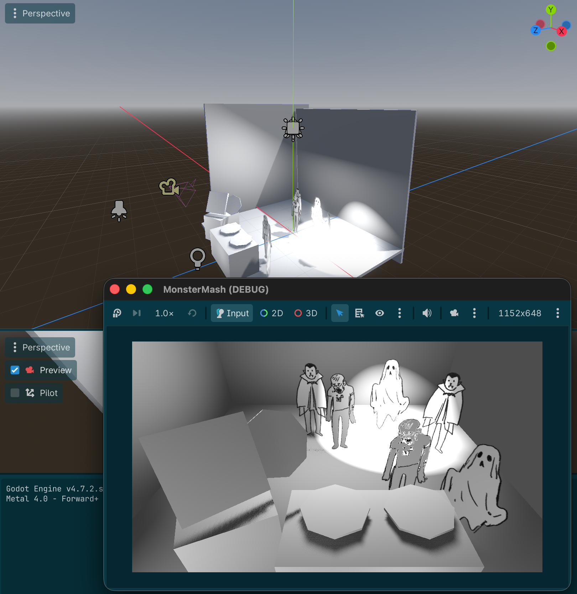
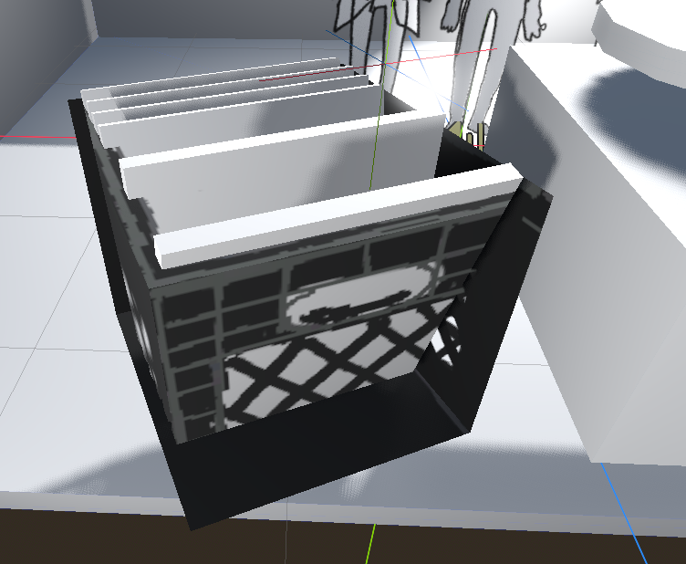

## MonsterMash game jam game

### Devlog

#### Starting out
Friday 10/9/26 - I've been working for about 3 weeks on a prototype for a game involving traversing tippy platforms, without making much progress on a playable prototype at all. Rory told us about the [Halloween Game Jam](https://itch.io/jam/the-halloween-jam-2026), and I wanted to see what I could do in Godot without relying on coding agents for help (I think that's where I'm running into problems with my prototype). 

So I started thinking about a game I could do that's manageably challenging and Halloween-related. 
##### Sketch

- Top right: initial idea about a graveyard-based spooky sound effect music loop creator. Realized how complicated a music loop creator would be to make for someone who is not a knowledgeable musician so dropped that idea.
- General right side: From top to bottom, sketching out ideas for a game with camera view (foreground, no dance floor), notes about what types of music different monsters might like:
    - slashers like human screams
    - vampires like spooky organs
    - zombies like groans and the word "brains"
    - ghosts like moaning/crooning and "boo"
    - skeletons like marimbas
    - victorian ghosts like crummy old victorian recordings of music
- Ideas for album covers
- Notes about sound effects/music to use
- Bottom right: what's the absolute MVP so I can actually make something playable?
    - player starts the game with 1 type of monster on the dance floor (ghosts, zombies, or vampires)
    - player figures out the dj system and gets the monsters dancing
    - another type of monsters arrive
    - try to get the whole group dancing
    - track/loop object (that can hold what the "good part" of a track is, who likes it, etc)
    - audio player
    - slider to mix L/R turntable
    - animation loops for not interested, getting warmer, dancing, going nuts
        - doodles for the monsters, start with 2d billboards in the 3d space
        - thinking I'll start with just bobbing the billboards around
- Top left: wrapping my head around how to approach the assets. I'm liking the idea of lowpoly with pixel art textures. The scale of the pixel art will be anchored by the album art. I'm trying to figure out what the "unit" of the gameworld visuals are, so that everything will feel cohesive.
    - By making the milk-crate a simple cube and texturing it like a milk crate (using alpha channel for gaps) I can avoid getting into the weeds modeling stuff
    - I think the record should be less than 1 unit thick, but will test out in layout how it looks. Either 1 unit thick, 1/2, or 1/4? Needs to be able to fit inside the album cover
    - Slider on the turntable
- Bottom left: Framing idea about a mad scientist telling you (the frankenstein'd assistant) to DJ for his party. Not going to do this, opening the game with a monster dance party poster is way faster and probably just as effective to get the concept across.

##### Rough layout

Here I roughed in the shapes and initial lighting in Godot to figure out the sizing and camera frame, with dance floor monsters billboarded as 3d sprites. You can see the room, some dancing monsters, your turntable, some records, the milk crate that will hold your albums, an album in "selected" state, and some initial lighting. 

##### End of day: 
I got the turntables turning, got the mixing slider working, and got the music hooked up to the mixing slider. 

#### Day 3

10/11/26 Sunday - Last night I messed around a bunch with Ableton Live and MIDI arrangements I found online for songs like Thriller and Ghostbusters and whatever that spooky vampire organ music is. I want to make the spooky organ music have a beat drop like *The 5th of Beethoven* (the disco version of Beethoven's 5th). Which means I have to make that part in Ableton. I'll work on that this evening, maybe.

I also want to make a short zombie song inspired by Quintron where the only words are "Brains". I'm thinking of Fire Waterfall. It's weird to think of music as something I could just **make** by clicking and assembling things on a computer instead of something I need to learn an instrument for.

##### Record Selection

Today I'm working on the record selection interactivity. I'm trying to think in Godot components, so it's structured like this:

- Milk Crate contains Album Cover (multiple instances)
    - Album Cover contains Record

Record is its own scene because it needs to be able to be unparented from Album Cover and adopted by Turntable1 or Turntable2, because once Record is selected the Album Cover will either go back in the Milk Crate or get placed near the Turntable and I don't want Album Cover's motion messing with Record's motion.

- Milk Crate has no animations but keeps track of the array of albums and connects user input to flipping through the array
- Album Cover has a state machine that handles its animations:
    - TILTED_POSITIVE: 15 deg x rotation
    - UPRIGHT: 0 deg x rotation
    - TILTED_NEGATIVE: -15 deg x rotation
    - SELECTED: transitioning between UPRIGHT and FLOATING
    - FLOATING: Lissajous or random noise-based floating movement, triggers Record to unsleeve
- Record has a state machine that handles its animations:
    - SLEEVED: sleeved inside Album Cover (visibility OFF)
    - ROLLED_OUT: Visible and ready to be picked
    - SELECTED: Unparent from Album Cover, animate to Turntable1 or Turntable2
    - PLAYING: Parented to Turntable1 or Turntable2
    - Record will also have a script that allows you to associate an audio track object with it in the editor. That way Turntable1 and Turntable2 can just find out what to play from their child Record node.

I *think* I don't need return states. The way I'm thinking about states is less about animation sequences and more about what ways the user can interact with them. So if "put the record back" is just an animation and has no opportunity for the player to interact with it in a special way, I can just treat that as a transitional animation, and "lock out" the player interaction until the transition is finished. 

##### Design

Yesterday I got a coffeetable book about Broadway set design from the library. Back in July I went and saw Rocky Horror on Broadway, and the set/lighting was really really cool. I think I'm just going to try to imitate elements of the Rocky Horror set and lighting for the dance party room. The book doesn't have Rocky Horror specifically, but it has lots of photos of other shows. I'll probably focus on that tomorrow.

##### Gameplay

I have a pretty good idea of how the gameplay should go. Each song has different effects on the types of monsters, depending on what they like. Each song also has at least one moment of super boost, where if you have it turned up for that moment it will have a big effect on one monster type. This would be like, the part of a song that says "Brains," if you have that track loud at that part, you'll get a big boost to your zombies dancing excitement without all the other monsters getting annoyed by the rest of the zombies song. 

6 records:
- Quintron zombie song's boost is "Brains" for zombies
- Funeral song's boost is "Woooo" or "Boo" for ghosts
- Spooky organ disco song's boost is the beat drop at the end for vampires
- Thriller's boost is the howl in the intro for wolfmen
- Monster Mash is a crowd pleaser but has no boosts in it
- Beetlejuice theme's boost is the marimba/xylophone for skeletons. Either this or Addams Family theme, which has the clapping/snapping sections that skeletons would like.

The effects have a decay over time, so you have to keep DJ'ing different stuff to get all the monsters to dance.

##### What I was able to do today

I got the records, album covers, and milk crate structured. I got the records to roll out of the cover and the album covers to pop up out of the milk crate on keystroke `e`, as a test. I learned some stuff around the difference between lerping and tweening, and where I would want to use multi-point bezier paths. I also ran into gimbal lock! And solved it with quaternion transform.

I'm keeping a sheet of notes with code snippets I know I will be referring back to often. It's already helping me understand better instead of looking things up constantly.

I didn't get to scrolling through the milk crate. I think I will have the records teleport onto the turntables/off the turntables instead of animating them, to start out. I can always go back and animate them if I feel like it after everything is working.

#### Day 3

10/12/26 Monday - Last night I worked more on different approaches to making things hover/float.

##### Scroll through albums in milkcrate

Yesterday I made it so the albums handle their own states and know if they're available to be selected, so to make them scrollable I'm going to make a scene-level script that creates an array of albums and sends them their state change instructions when the player scrolls through. 

I need to keep the input handling separate from the actions the inputs trigger, because I want to make a port of the game for the Rcade and I want to make it easy to map those inputs in.

This is a good reason to read about Godot's array methods.

Also, in order to see if scrolling through the albums is working, I need to be able to see the albums. 

transparent because I didn't set the texture transparency to "alpha scissor." Fixed when I did that.

I got that working! There's some weird interrupt stuff happening sometimes but I'm not sure what the right approach to locking off interaction is.

##### Put record onto turntable

I'll just teleport the record onto and off of the turntable. What happens to the album covers? I think they should teleport too. 

##### Add record label handling and album cover handling

Added editor-level handling for album cover 3d sprites and record label 3d sprites. The album object accepts textures and will populate them on itself and its record.

##### Add more monsters

Added a skeleton and a wolfman.

##### Think about interaction on Rcade

I'll need to do an outline shader for the Rcade version of the game, because you can't use the mouse to click where you want. You have to scroll through with the joystick, so it needs to be clear what element is active. I found a [tutorial from CrookedSmile on Youtube](https://www.youtube.com/watch?v=Wxz4X4yKC9Q) but I'm not sure if it will work on the entire group (milk crate and albums as a unit)? I guess just the milk crate would be fine. I was worried about the shader acting weird because of the holes in the milk crate and then I remembered the milk crate doesn't have holes, it's just a cube with transparency in the texturing. 

##### Next up:

I need to model the turntable station in Blender.

##### Next steps:

- [ ] Figure out a design for the turntables to use records
- [ ] Make rough loop animation for the monsters dancing
- [ ] Make the ghosts react negatively when player plays Ghostbusters
- [ ] Add camera active/dead zone to change the view a little when the mouse gets to the edges
- [ ] Make some goofy songs for the albums
- [ ] Figure out how to get all the songs on 120 bpm in Ableton
- [ ] Prevent the songs from starting to play off-beat 
- [ ] Make album covers in aseprite
- [ ] Design the room & lighting
- [ ] Model and texture the props/room in Blender/aseprite
